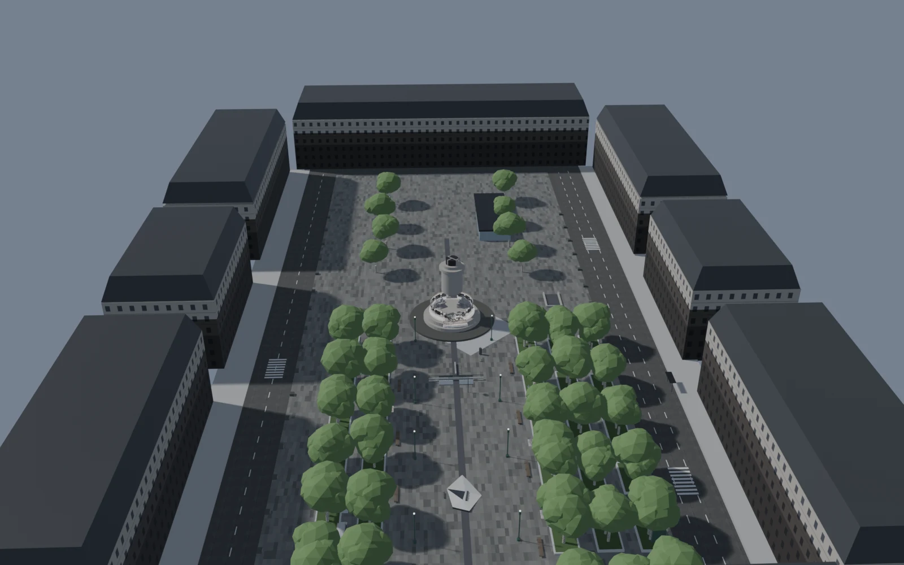
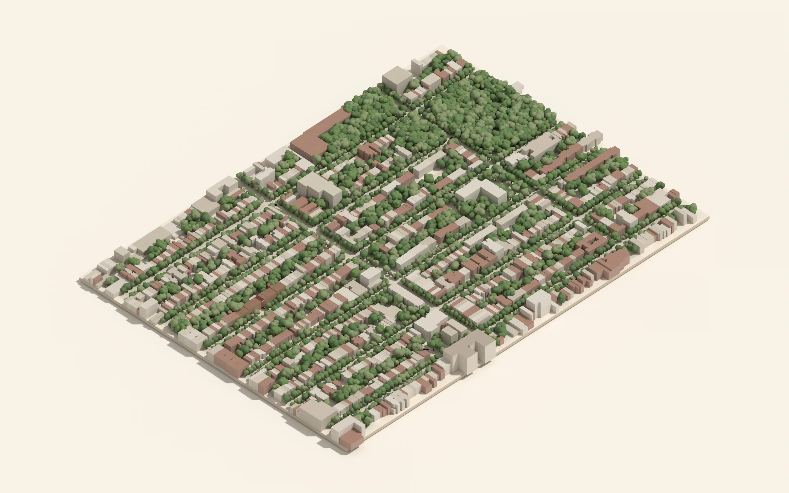
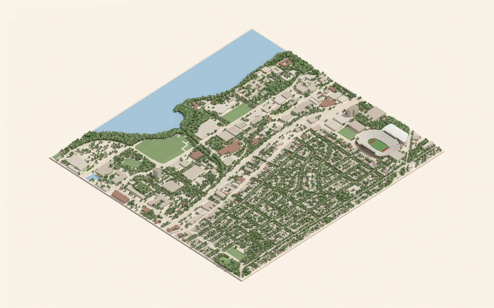
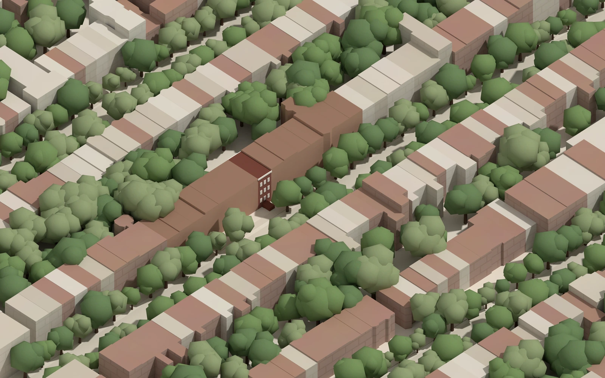
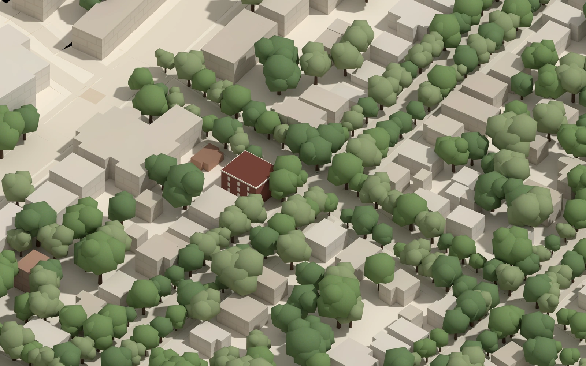

# 3D cities

City scenes I build in Blender, from open map data and survey data, rendered headless.

## Place de la République, Paris



A walkable model of the République plaza, built in Blender 5.1 and modelled live through the
Blender MCP connector with Claude. Dimensions come from measurement, not guesswork:

- **IGN LiDAR HD** point cloud as the ruler: plaza rotation (−43.0°, from a principal-component fit
  on the 18,292 m² concourse slab), the monument step (0.44 m, 66 m of ledge).
- **Tile counting** from street-level photos: the paving module is 1.92 × 0.68 m, so counting squares
  in any frame gives real dimensions (that is how the 12 × 4 m three-step pad was measured).
- Every value in the scene is tagged with its source (`_LIDAR`, `_PHOTO`, `_STREETVIEW`, `_GUESS`),
  so it is always clear which numbers to trust.

Render: `scripts/render_birdseye.py` frames all meshes from a bird's-eye camera and renders with
EEVEE, without modifying the .blend:

```bash
OUT=./out blender -b republique_map.blend -P scripts/render_birdseye.py
```

## Neighbourhood dioramas: Bed-Stuy (Brooklyn) and Madison (Wisconsin)





| | |
|---|---|
|  |  |

Isometric dioramas made for [Avenida Greene](https://avenidagreene.com), a small rental portfolio,
to show each property in its neighbourhood. The pipeline is fully scripted:

1. **Fetch** buildings, streets, parks, water and trees from OpenStreetMap (Overpass API); for
   Brooklyn, real roof heights from NYC Open Data building footprints.
2. **Prepare** (Python, Shapely): project to a local metric frame, rotate to the street grid, clip to
   a near-square window, merge road centre lines, polygonise open ground, write a scene JSON.
3. **Build and render** (Blender `bpy`, headless): extrude buildings from footprints and heights,
   lay streets and lawns, scatter procedural trees, apply a small material palette, render with
   Cycles at 256 samples (two crops per city, about 2 to 4 minutes each on a 16-core CPU).

The pipeline code lives in the client's project; this repository shows the output.

## Credits

- Map data © OpenStreetMap contributors, available under the
  [Open Database License](https://www.openstreetmap.org/copyright).
- Building footprints and heights: NYC Open Data, Building Footprints dataset.
- République survey: IGN LiDAR HD (Licence Ouverte / Etalab).

Renders and scripts © 2026 Brenn Daude. Scripts under the MIT licence (see LICENSE).
